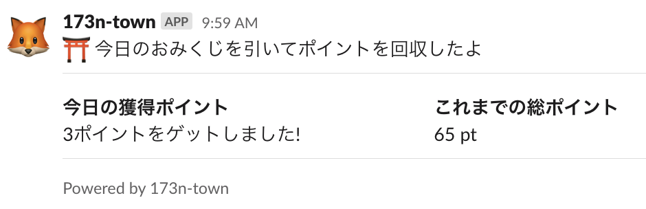

# 173n-town

Crawling the 173n Town website and posting "Omikuji" results to Slack.



## Getting started

```
docker run --rm -it \
  -e TOWN_USER=[Email address] \
  -e TOWN_PASS=[Raw password] \
  -e SLACK_WEBHOOK_URL=[Slack incomming webhook URL] \
  ghcr.io/windyakin/173n-town
```

## Environments

Variable name | Description | Example
:-- | :-- | :--
`TOWN_USER` * | 173n Town login ID (Email address) | `173n-town@example.com`
`TOWN_PASS` * | 173n Town login password (Raw value) | `passw0rd`
`SLACK_WEBHOOK_URL` * | [Incomming webhook url of Slack](https://api.slack.com/incoming-webhooks) to post | `https://hooks.slack.com/...`
`PUPPETEER_TIMEOUT` | [Puppeteer](https://github.com/puppeteer/puppeteer) time out time (milli second). Default value is 30000 | `30000`
`CHROME_EXECUTABLE_PATH` | Entrypoint path of Google Chrome (puppeteer's `executablePath` option) | `/usr/bin/chromium`

`*`: Required parameters

## Running on Kubernetes with a read-only filesystem

The image runs as the `node` user (UID/GID 1000). Puppeteer's temporary browser profile, Chromium's configuration and cache, and npm's cache and logs are configured to use `/tmp`. Mount an `emptyDir` there and set the Pod's `fsGroup` so the user can write to the volume.

For example, create a Secret named `173n-town` containing `TOWN_USER`, `TOWN_PASS`, and `SLACK_WEBHOOK_URL`, then use the following Pod configuration (or its `spec` in a Job/CronJob Pod template):

```yaml
apiVersion: v1
kind: Pod
metadata:
  name: 173n-town
spec:
  restartPolicy: Never
  securityContext:
    runAsUser: 1000
    runAsGroup: 1000
    fsGroup: 1000
  containers:
    - name: app
      image: ghcr.io/windyakin/173n-town
      envFrom:
        - secretRef:
            name: 173n-town
      securityContext:
        readOnlyRootFilesystem: true
        runAsNonRoot: true
        allowPrivilegeEscalation: false
        capabilities:
          drop: ["ALL"]
        seccompProfile:
          type: RuntimeDefault
      volumeMounts:
        - name: tmp
          mountPath: /tmp
  volumes:
    - name: tmp
      emptyDir: {}
```

The `/tmp` environment settings are included in the image; no home-directory or application-directory volume is needed for the current application.

Chromium's sandbox remains enabled. If Chromium reports `No usable sandbox!` or `Operation not permitted`, check the node's user namespace, seccomp, and AppArmor configuration.

## License

This program is under the [MIT License](LICENSE)

## Copyright

&copy; 2022 windyakin
